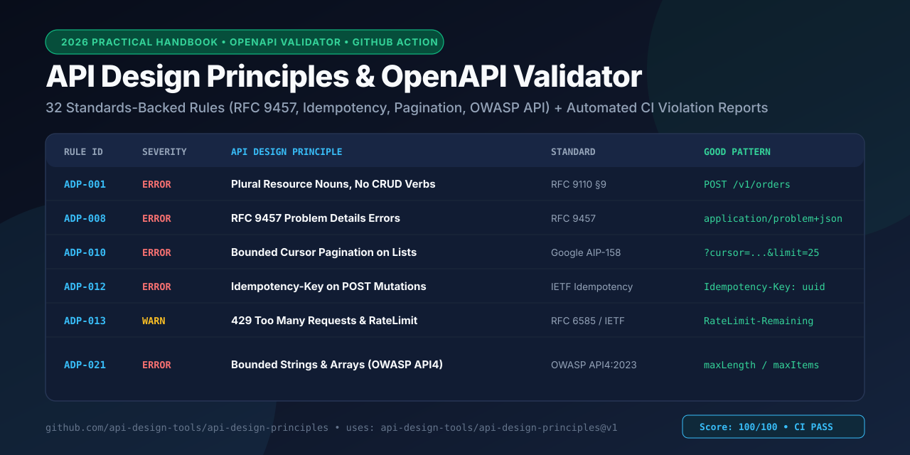

<div align="center">

# API Design Principles, REST Style Guide & Free OpenAPI Validator (2026)

**A practical, standards-backed API design principles handbook paired with a free zero-dependency OpenAPI 3.0/3.1 validator, a drop-in GitHub Action, and automated rule-violation reports.**

[](#-complete-32-rule-api-design-principles-matrix)
[](#-quick-start-validate-your-openapi-spec-in-10-seconds)
[](#-github-action-automated-pr--ci-violation-reports)
[](LICENSE)

[**⚡ Quick Start CLI**](#-quick-start-validate-your-openapi-spec-in-10-seconds) • [**🤖 GitHub Action**](#-github-action-automated-pr--ci-violation-reports) • [**🌐 Live Browser Validator**](https://api-design-tools.github.io/api-design-principles/) • [**📋 32 Core Principles**](#-complete-32-rule-api-design-principles-matrix) • [**📊 Violation Report Demo**](#-sample-rule-violation-report) • [**📚 Deep-Dive Guides**](#-deep-dive-api-design-guides--interactive-tools) • [**❓ FAQ**](#-frequently-asked-questions-faq)

</div>

---

## Why This Repository Exists (Principles You Can Actually Enforce)

Most **API design principles** pages on GitHub—such as *Haufe-Lexware API Style Guide* or static enterprise wikis—only publish **abstract theory and reading links**. Teams read the checklist once, and three months later production services still ship with `/getUserOrders/`, missing `Idempotency-Key` headers, unbounded arrays, and ad-hoc `{ "error": "..." }` payloads.

**`api-design-principles`** closes the gap between **API design theory** and **CI/CD enforcement**:
1. **Practical Handbook with Real HTTP/JSON Examples** — 32 actionable rules mapped directly to `RFC 9110`, `RFC 9457` (Problem Details), `RFC 8594` (Sunset), `IETF Idempotency-Key`, `IETF RateLimit`, `Google AIP`, and the `OWASP API Security Top 10`.
2. **Free Zero-Dependency OpenAPI Validator** — Run `api_validator.py` locally (`Python 3.9+` stdlib only) or paste your spec into our [**Interactive Browser OpenAPI Validator**](https://api-design-tools.github.io/api-design-principles/).
3. **Drop-in GitHub Action (`action.yml`)** — Enforce your adopted API design rules automatically on every Pull Request across one or multiple repositories.
4. **Actionable Rule-Violation Reports** — Emit clean Markdown GitHub Step Summaries, terminal scorecards (`0–100`), or machine-readable JSON audit reports.



---

## ⚔️ How We Compare to Static API Style Guides & Heavy Linters

| Capability | Static Style Guides *(e.g. Haufe-Lexware / Docs)* | Generic Linters *(e.g. Spectral CLI)* | **api-design-tools / api-design-principles** |
| :--- | :---: | :---: | :---: |
| **Practical API Design Handbook + HTTP Examples** | ✅ Theory & links | ❌ Tooling only (bring your own rules) | ✅ **32 RFC-backed rules + bad/good HTTP examples** |
| **Free OpenAPI 3.0 / 3.1 Validator** | ❌ None (read-only Markdown) | ✅ Node.js CLI | ✅ **Zero-dependency Python CLI + Browser UI** |
| **Drop-in GitHub Action + Step Summary Report** | ❌ None | ⚠️ Requires custom setup | ✅ **Built-in `action.yml` + Markdown/JSON reports** |
| **0–100 API Design Compliance Score** | ❌ None | ❌ Pass/fail lint lines only | ✅ **Weighted scorecard + per-rule severity** |
| **Team Custom Rulesets & Multi-Repo Audit** | ❌ Manual review | ✅ `.spectral.yaml` | ✅ **`.api-rules.json` + multi-spec glob support** |

---

## ⚡ Quick Start: Validate Your OpenAPI Spec in 10 Seconds

### 1. Run Locally with Zero Dependencies (`Python 3.9+`)

```bash
# Clone the repository
git clone https://github.com/api-design-tools/api-design-principles.git
cd api-design-principles

# Validate the compliant reference spec (Score: 100/100)
python3 api_validator.py --spec examples/orders-api-good.openapi.json --fail-on warning

# Inspect rule violations on an anti-pattern spec as a Markdown report
python3 api_validator.py --spec examples/orders-api-bad.openapi.json --format markdown --fail-on none

# Browse all 32 API design principles or print a pre-production checklist
python3 api_validator.py --rules
python3 api_validator.py --checklist
```

### 2. Validate Live in Your Browser (No Install Required)

Open the [**Interactive OpenAPI Design Validator**](https://api-design-tools.github.io/api-design-principles/) to paste or upload any OpenAPI 3.0/3.1 JSON specification, test built-in Good vs. Bad Order API presets, and export a **Markdown / JSON Violation Report**.

---

## 🤖 GitHub Action: Automated PR & CI Violation Reports

Add this workflow (`.github/workflows/api-design.yml`) to any service repository to block breaking or insecure API designs before merge and publish a **Violation Report** directly to the GitHub Actions job summary:

```yaml
name: API Design Principles Check

on:
  pull_request:
    paths:
      - "**/openapi*.json"
      - ".api-rules.json"

jobs:
  api-lint:
    runs-on: ubuntu-latest
    steps:
      - uses: actions/checkout@v4

      - name: Validate OpenAPI Against Adopted API Design Principles
        uses: api-design-tools/api-design-principles@v1
        with:
          spec: "services/**/openapi.json"
          config: ".api-rules.json"
          fail-on: "error"
          report-format: "markdown"
          output-file: "api-design-report.md"
          write-summary: "true"
```

### Action Inputs & Outputs
- **Inputs:** `spec` (file or glob pattern), `config` (optional team rule overrides), `fail-on` (`error` | `warning` | `none`), `report-format` (`markdown` | `json` | `text`), `output-file`, `write-summary`.
- **Outputs:** `score` (`0–100`), `errors`, `warnings`, `passed` (`true`/`false`), `report-path`.

---

## 📋 Complete 32-Rule API Design Principles Matrix

Every rule below is cataloged in [`rules.json`](rules.json). Rules marked **🤖 Auto** are automatically enforced by `api_validator.py`, the Browser Validator, and the GitHub Action.

### 1. URI Naming, Versioning & HTTP Method Semantics

| ID | Check | Severity | Principle & Standard | Bad Example | Good Example |
| :--- | :---: | :---: | :--- | :--- | :--- |
| **ADP-001** | 🤖 Auto | `ERROR` | **Plural resource nouns, no CRUD verbs** (`RFC 9110 §9`) | `GET /v1/getOrders` | `GET /v1/orders` |
| **ADP-002** | 🤖 Auto | `WARN` | **Lowercase `kebab-case` URI segments** (`Google AIP-122`) | `/v1/orderItems` | `/v1/order-items` |
| **ADP-003** | 🤖 Auto | `WARN` | **No trailing slashes** (`RFC 3986`) | `GET /v1/orders/` | `GET /v1/orders` |
| **ADP-004** | 🤖 Auto | `ERROR` | **Explicit major API versioning** (`AIP-185`) | `GET /orders` | `GET /v1/orders` |
| **ADP-005** | 🤖 Auto | `ERROR` | **`GET`/`HEAD` must never declare `requestBody`** (`RFC 9110 §9.3.1`) | `GET` + JSON body | `GET ?status=paid` |
| **ADP-006** | 🤖 Auto | `WARN` | **`DELETE` returns `204`/`202`, no required body** (`RFC 9110 §9.3.5`) | `DELETE` + body -> `200` | `DELETE /v1/orders/{id}` -> `204` |
| **ADP-007** | 🤖 Auto | `ERROR` | **`POST` creation returns `201` (`Location`) or `202`** (`RFC 9110`) | `POST /v1/orders` -> `200` | `201 Created` + `Location` |
| **ADP-018** | 🤖 Auto | `INFO` | **`Deprecation` & `Sunset` headers on deprecated routes** (`RFC 8594`) | `deprecated: true` only | `Sunset: Wed, 31 Dec 2026...` |
| **ADP-020** | 🤖 Auto | `WARN` | **`PATCH` for partial updates + `ETag`/`If-Match`** (`RFC 7396`) | Unconditional `PUT` | `PATCH` + `If-Match` |

### 2. Error Handling (`RFC 9457`), Pagination, Idempotency & Rate Limiting

| ID | Check | Severity | Principle & Standard | Bad Example | Good Example |
| :--- | :---: | :---: | :--- | :--- | :--- |
| **ADP-008** | 🤖 Auto | `ERROR` | **Use `application/problem+json` for 4xx/5xx** (`RFC 9457`) | `{ "msg": "bad" }` | `{ "type": "...", "title": "...", "status": 400 }` |
| **ADP-009** | 🤖 Auto | `ERROR` | **Explicit 4xx / default error responses** (`OpenAPI 3.1`) | Only `200` documented | `200`, `400`, `401`, `404`, `429` |
| **ADP-010** | 🤖 Auto | `ERROR` | **Collection `GET` must support pagination** (`OWASP API4`) | Unbounded array | `?cursor=...&limit=25` |
| **ADP-011** | 🤖 Auto | `WARN` | **Prefer keyset/cursor over `offset` pagination** (`AIP-158`) | `?offset=50000` | `?cursor=ord_01J9Z&limit=25` |
| **ADP-012** | 🤖 Auto | `ERROR` | **`Idempotency-Key` on `POST` mutations** (`IETF Draft`) | `POST /v1/orders` raw | `Idempotency-Key: <uuid>` |
| **ADP-013** | 🤖 Auto | `WARN` | **`429 Too Many Requests` + `RateLimit-*` headers** (`RFC 6585`) | Undocumented throttling | `429` + `Retry-After` + `RateLimit-*` |

### 3. Security (`OWASP API Top 10`), Schemas & AI/Agent Readiness

| ID | Check | Severity | Principle & Standard | Bad Example | Good Example |
| :--- | :---: | :---: | :--- | :--- | :--- |
| **ADP-014** | 🤖 Auto | `ERROR` | **Enforce `https://` server URLs** (`OWASP API8:2023`) | `http://api.example.com` | `https://api.example.com/v1` |
| **ADP-015** | 🤖 Auto | `ERROR` | **Declare `securitySchemes` & operation auth** (`OWASP API2`) | Missing auth definitions | `BearerAuth` (OAuth2/JWT) |
| **ADP-016** | 🤖 Auto | `WARN` | **Never pass API keys/tokens in query strings** (`RFC 6750`) | `?api_key=sk_live_...` | `Authorization: Bearer ...` |
| **ADP-017** | 🤖 Auto | `WARN` | **Unique `operationId` & concise `summary`** (`OpenAPI / MCP`) | Missing/duplicate IDs | `operationId: listOrders` |
| **ADP-019** | 🤖 Auto | `WARN` | **Realistic `example` on media types/schemas** (`OpenAPI 3.1`) | Schema without example | Concrete JSON example |
| **ADP-021** | 🤖 Auto | `ERROR` | **Bound strings (`maxLength`) & arrays (`maxItems`)** (`OWASP API4`) | Unbounded `type: array` | `maxItems: 50`, `maxLength: 128` |
| **ADP-022** | 🤖 Auto | `INFO` | **ISO 8601 UTC `format: date-time` timestamps** (`RFC 3339`) | `created_at: { type: string }` | `format: date-time` |
| **ADP-023 – 032** | 🏛️ Arch | `MIXED` | **BOLA/IDOR scoping, UUIDv7/ULID IDs, Signed Webhooks, `202` async jobs, integer minor-unit money, W3C `traceparent`, REST vs GraphQL vs gRPC, MCP readiness** | Raw floats, unsigned webhooks | `amount_minor` + HMAC-SHA256 |

---

## 📊 Sample Rule-Violation Report

Running `python3 api_validator.py --spec examples/orders-api-bad.openapi.json --format markdown` outputs an instant, CI-ready violation report:

```markdown
## API Design Principles — Validation Report

### `examples/orders-api-bad.openapi.json` — Legacy Anti-Pattern Orders API (**FAIL**, Score: `0/100`)

- **OpenAPI Version:** `3.0.3` • **Operations Checked:** `4`
- **Violations:** `22` Errors • `24` Warnings • `2` Info

| Severity | Rule | Location | Violation | Standard |
| :--- | :--- | :--- | :--- | :--- |
| `ERROR` | **ADP-014** | `servers[0].url` | Insecure HTTP server URL 'http://api.legacy-shop.internal' detected... | OWASP API8:2023 |
| `ERROR` | **ADP-001** | `/getUserOrders/` | Segment 'getUserOrders' looks like a CRUD verb; use plural resource nouns... | RFC 9110 §9 |
| `ERROR` | **ADP-005** | `GET /getUserOrders/` | GET operation declares a requestBody, which violates RFC 9110 §9.3.1. | RFC 9110 §9.3.1 |
| `ERROR` | **ADP-012** | `POST /createOrder` | POST mutation does not declare an Idempotency-Key header parameter... | IETF Idempotency |
| `ERROR` | **ADP-008** | `POST /createOrder (400)` | Error responses do not use RFC 9457 media type 'application/problem+json'. | RFC 9457 |
```

---

## 🏢 Shared Team Rulesets & Multi-Repository Audits

Platform engineering and API governance teams can share a single baseline ruleset file (see [`.api-rules.example.json`](.api-rules.example.json)) across dozens of microservice repositories:

```bash
# Enforce a shared team ruleset across multiple microservice OpenAPI specs
python3 api_validator.py \
  --spec "services/*/openapi.json" \
  --config .api-rules.example.json \
  --format json \
  --output reports/org-api-audit.json
```

Shared config supports `disabled_rules`, `severity_overrides` (e.g., promoting `ADP-011` offset warnings to `error`), `allowed_version_prefixes`, and `ignore_paths` (such as `/healthz` or `/metrics`).

---

## 📚 Deep-Dive API Design Guides & Interactive Tools

| Topic / Guide | Markdown Guide (GitHub) | Interactive Web Page (GitHub Pages) | Standards Covered |
| :--- | :--- | :--- | :--- |
| **Interactive OpenAPI Validator & Rules Explorer** | [`api_validator.py`](api_validator.py) | [**Live Browser Validator →**](https://api-design-tools.github.io/api-design-principles/) | All 32 rules, live JSON linting, Markdown/JSON export |
| **REST Naming & HTTP Method Semantics** | [**Naming & Methods Guide**](guides/rest-api-naming-and-http-semantics.md) | [**rest-naming-and-methods.html**](https://api-design-tools.github.io/api-design-principles/rest-naming-and-methods.html) | `RFC 9110`, `RFC 7396` Merge Patch, `ETag` / `If-Match` |
| **Pagination, Filtering & Sorting** | [**Pagination & Filtering Guide**](guides/pagination-filtering-and-sorting.md) | [**pagination-and-filtering.html**](https://api-design-tools.github.io/api-design-principles/pagination-and-filtering.html) | Keyset cursors vs. `OFFSET`, `Google AIP-158`, `OWASP API4` |
| **Error Handling & HTTP Status Codes** | [**RFC 9457 Error Guide**](guides/error-handling-rfc9457-and-status-codes.md) | [**error-handling-rfc9457.html**](https://api-design-tools.github.io/api-design-principles/error-handling-rfc9457.html) | `RFC 9457` `application/problem+json`, `409` vs `412` vs `422` |
| **Versioning, Idempotency & Rate Limits** | [**Versioning & Resilience Guide**](guides/api-versioning-idempotency-and-rate-limiting.md) | [**versioning-idempotency-rate-limits.html**](https://api-design-tools.github.io/api-design-principles/versioning-idempotency-rate-limits.html) | `Idempotency-Key`, `RFC 8594` `Sunset`, `RateLimit-*` |
| **REST vs GraphQL vs gRPC vs Webhooks** | [**Architecture Matrix Guide**](guides/rest-vs-graphql-vs-grpc-vs-webhooks.md) | [**rest-vs-graphql-vs-grpc.html**](https://api-design-tools.github.io/api-design-principles/rest-vs-graphql-vs-grpc.html) | HTTP caching, Protobuf, HMAC Webhooks, SSE, AI/MCP tools |

---

## ❓ Frequently Asked Questions (FAQ)

### What are the most important REST API design principles in 2026?
The highest-impact principles are: (1) using **plural resource nouns** and standard HTTP methods (`RFC 9110`), (2) returning standardized **`RFC 9457` Problem Details** (`application/problem+json`) on `4xx`/`5xx`, (3) enforcing **bounded cursor pagination** on collection `GET` endpoints, (4) requiring **`Idempotency-Key`** headers on `POST` mutations, (5) documenting **`429` and `RateLimit-*` headers**, and (6) constraining all input strings and arrays (`OWASP API4:2023`).

### How is this different from static API style guides like Haufe-Lexware or Zalando?
Static markdown style guides explain conventions for humans to read, but they cannot automatically verify your API contracts in Pull Requests. **`api-design-principles`** bundles a practical handbook *and* a zero-dependency OpenAPI 3.0/3.1 validator (`api_validator.py`), a browser-based validator, and a drop-in GitHub Action that produces pass/fail scores and violation tables.

### Does the OpenAPI validator require Node.js, Docker, or external packages?
No. `api_validator.py` uses **only the Python 3 standard library** for OpenAPI JSON specs (and optionally supports YAML if `PyYAML` is installed). It runs cleanly on `ubuntu-latest`, `macos-latest`, and `windows-latest` GitHub Actions runners in milliseconds.

### Why does RFC 9457 replace RFC 7807 for API error responses?
`RFC 9457` (published July 2023) obsoleted `RFC 7807` as the IETF standard for HTTP Problem Details. It preserves the `application/problem+json` media type and `type`/`title`/`status`/`detail`/`instance` fields while clarifying multiple problem types, registry management, and extension members.

### How can my team enforce custom rules across multiple repositories?
Create a shared `.api-rules.json` file (modeled after [`.api-rules.example.json`](.api-rules.example.json)) to disable specific rules, promote warnings to errors, or set custom version prefixes like `/api/v1`, then point your repositories' GitHub Actions to that config.

---

## 🤝 Contributing & Tests

Run the unit test suite locally before opening a Pull Request (see [`CONTRIBUTING.md`](CONTRIBUTING.md)):

```bash
python3 -m unittest discover -s tests -v
```

## ⭐ Support the Project

**If this handbook and OpenAPI validator caught an API bug before production, please give the repository a Star ⭐!**

## 📄 License

Distributed under the **MIT License**. See [`LICENSE`](LICENSE) for details.
